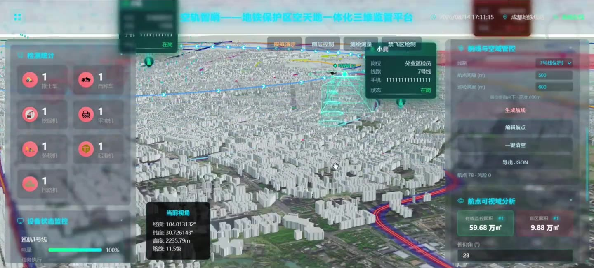
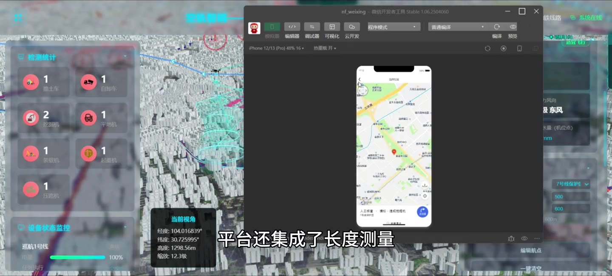

# 低空巡查巡检 · 空轨智哨

> **地铁保护区空天地一体化三维监管平台** — 基于 **Cesium** 的无人机低空巡查三维可视化系统
>
> Vue 3 + Vite + Pinia + Element Plus + **CesiumJS**

<p>
  
  
  
  
</p>

---

## ⚠️ 请先阅读：这是一个「精简开源版」

本仓库**不是**可以直接上线的完整系统，而是从完整项目中**抽取出来的前端核心代码**，
用于展示三维可视化与无人机巡查引擎的实现思路。

**完整项目还包含以下部分，均未包含在本仓库中：**

| 未包含的部分 | 说明 |
| :--- | :--- |
| 🐍 **Flask 后端** | `backend/` 提供 REST API、Socket.IO 实时推送、YOLO 视频巡检检测、气象数据采集与 AI 问答。前端按 `/api` 约定调用，**仓库里没有实现** |
| 📱 **微信小程序端** | 工作人员移动端：上线管理、任务接收、二维地图测量、异常上报。**仓库里没有代码** |
| ☁️ 体积云 / 大气散射 | 基于开源库 `cesium-clouds-atmosphere` 二次开发，依赖大量二进制噪声纹理，未包含 |
| 🏙️ 城市白膜数据 | 倾斜摄影 / 白膜 3D Tiles 数据集（约 130 MB），体积过大，未包含 |
| 🧠 AI 模型权重 | YOLO 施工机械检测权重 `best.pt`（约 6 MB），未包含 |
| 📊 业务数据 | `db.json`（人员、机队、违规、航线计划等演示数据），未包含 |
| 🎯 三维立体可视域体渲染 | 依赖商业发行版的扩展类，开源版降级为 **2.5D 面积估算 + 矢量盲区** |

因此：

- ✅ 你可以直接阅读 / 复用其中的 **Cesium 三维代码**（场景初始化、图层、航线、视域、特效）；
- ⚠️ 本仓库是**从完整工程中抽取的代码片段**，与完整项目并非逐行一致，**不承诺开箱即可运行**；
- ✅ 抽取后依赖已重新整理，`npm run build` 可以通过（仅作为结构完整性的最低验证）；
- ❌ 「检测统计 / 天气实况 / 违规告警」等面板需要你自建后端才会出数据；
- ❌ 白膜建筑、体积云、三维立体可视域需要自行准备数据或自行对接。

---

## 📺 演示视频

[](docs/media/demo.mp4)

> 点击封面观看演示视频（**3 分 16 秒 · 1440×652 · H.264 · 39 MB**）。
> 视频文件位于 [`docs/media/demo.mp4`](docs/media/demo.mp4)，可直接下载播放。

演示内容依次为：三维城市场景漫游 → 地铁线路与保护区 → 无人机沿线路自动巡航 →
航点可视域面积分析 → 气象图层（风场 / 降雨）→ **微信小程序端**任务与测量。

### 📱 微信小程序端（未包含）

除了本仓库的 Web 三维端，完整系统还有一个面向现场工作人员的**微信小程序端**，
负责上线管理、任务接收、二维地图测量与异常上报：



> 小程序端代码**不在本仓库中**，此处仅作功能说明。


---

## ✨ 功能概览

| 模块 | 能力 | 核心文件 |
| :--- | :--- | :--- |
| **三维场景** | Viewer 初始化、单层底图、高 DPI canvas 校正、相机聚焦 | `src/utils/cesium/sceneInit.js` |
| **图层管理** | 图层注册表、影像图层、3D Tiles、GeoJSON 统一开关 | `src/utils/cesium/layerManager.js` |
| **城市白膜** | `Cesium3DTileset` 加载、SSE / 显存控制、遮挡关系调优 | `src/utils/cesium/layerManager.js` |
| **地铁线路** | GeoJSON 矢量加载、线路配色、保护区缓冲 | `layerManager.js` / `safetBuffer.js` |
| **无人机巡航** | 沿线路航点插值、平滑巡航、姿态朝向、电量模拟 | `src/utils/dronePatrolEngine.js` |
| **航线规划** | 航点生成、禁飞区规避、风场/降雨风险再分类 | `src/utils/routeGeometry.js`、`cesium/routePlannerManager.js` |
| **风险研判** | 地铁保护区缓冲、最小距离、风险分级 | `src/utils/safetBuffer.js` |
| **可视域分析** | 航点视域估算、有效监控面积 / 盲区面积 | `cesium/viewshedController.js`、`cesium/viewshedAreaEstimate.js` |
| **气象图层** | 风场粒子流、降雨粒子系统、气象热力图 | `cesiumWindLayer.js`、`rainEffect.js` |
| **标记与特效** | 无人机 GLTF 模型、人员标记、脉冲环、违规光束、锥形扫描 | `mapMarkerEffects.js`、`radarScanEffect.js` |
| **测量工具** | 距离 / 面积 / 高度三维量算 | `surveyMeasureManager.js` |
| **大屏 UI** | 头栏 / 左右面板 / 工具栏 / 告警浮层 | `src/components/`、`src/views/Dashboard.vue` |

---

## 🧭 技术架构

```mermaid
graph TB
    subgraph 浏览器
        UI[Vue 3 大屏 UI<br/>Element Plus + Pinia]
        MAP[Enhanced3DMap.vue<br/>三维主视图]
        UTIL[Cesium 工具层<br/>utils/*]
        CES[CesiumJS 引擎<br/>全局 window.Cesium]

        UI --> MAP
        MAP --> UTIL
        UTIL --> CES
    end

    subgraph 数据
        TILES[3D Tiles<br/>城市白膜]
        GEO[GeoJSON<br/>地铁线路]
        IMG[影像瓦片<br/>高德 / 天地图]
    end

    CES --> TILES
    CES --> GEO
    CES --> IMG

    MAP -. 可选 .-> API[Flask 后端<br/>未包含]
    API -. Socket.IO .-> UI
```

**为什么用全局 `window.Cesium` 而不是 ESM 打包？**

Cesium 依赖大量 Web Worker 与静态资源，其加载路径由 `window.CESIUM_BASE_URL` 决定。
本项目把 `node_modules/cesium/Build/Cesium` 复制到 `public/cesium/`，通过
`<script src="/cesium/Cesium.js">` 全局引入，业务代码再通过
[`src/utils/cesiumCompat.js`](src/utils/cesiumCompat.js) 的 Proxy 拿到引擎实例。
这样做的好处是 **Worker 路径确定性好、可完全离线部署、避免双实例**。

---

## 🗂️ 目录结构

```
.
├── docs/media/              # 演示视频与截图
├── public/
│   ├── geodata/             # 地铁线路 GeoJSON、危险车辆点
│   ├── image/ textures/     # 贴图资源
│   ├── libs/                # 风场 / 热力图 / 克里金算法
│   ├── models/              # 无人机 GLTF 模型
│   └── cesium/              # Cesium 运行时（npm run prepare:cesium 生成，不进仓库）
├── scripts/
│   └── copy-cesium.js       # 复制 Cesium 静态资源到 public/cesium/
└── src/
    ├── components/          # 大屏组件（三维主视图、面板、工具栏）
    ├── views/Dashboard.vue  # 大屏页面
    ├── stores/              # Pinia 状态（机队、巡航、检测）
    ├── api/                 # 后端接口封装（需自建后端）
    ├── config/cesium.js     # 场景与数据源配置
    └── utils/
        ├── cesium/          # ★ Cesium 场景层：初始化 / 图层 / 航线 / 视域
        ├── dronePatrolEngine.js   # ★ 无人机巡航引擎
        ├── routeGeometry.js       # ★ 航线几何、禁飞区、风险再分类
        ├── safetBuffer.js         # ★ 地铁保护区缓冲与风险研判
        ├── mapMarkerEffects.js    # 标记与特效
        ├── rainEffect.js          # 降雨粒子
        ├── heatmap3dCore.js       # 三维热力图
        └── ...
```

标 ★ 的为完整项目中最核心、最具技术含量的部分。

---

## 🚀 快速开始

### 环境要求

- Node.js ≥ 18（推荐 20 / 22）
- 现代浏览器（Chrome / Edge，需支持 WebGL 2）

### 安装与运行

```bash
# 1. 安装依赖（postinstall 会自动把 Cesium 静态资源复制到 public/cesium/）
npm install

# 2. 启动开发服务器
npm run dev
# → http://localhost:3000
```

若 `public/cesium/` 没有生成，可手动执行：

```bash
npm run prepare:cesium
```

### 构建

```bash
npm run build      # 输出到 dist/
npm run preview    # 本地预览构建产物
```

### 配置

复制 `.env.example` 为 `.env.development` 后修改，常用项：

| 变量 | 说明 |
| :--- | :--- |
| `VITE_BASEMAP` | 底图：`gaode` / `tianditu` / `osm` / `cesium-ion` / `natural-earth` |
| `VITE_TIANDITU_TOKEN` | 天地图 key（`tianditu` 模式需要） |
| `VITE_CESIUM_ION_TOKEN` | Cesium Ion token（`cesium-ion` 模式需要） |
| `VITE_BUILDING_TILESET` | 城市白膜 `tileset.json` 地址（留空则跳过） |
| `VITE_BUILDING_SSE` | 白膜屏幕空间误差，越小越精细 |
| `VITE_SUBWAY_GEOJSON` | 地铁线路 GeoJSON 路径 |
| `VITE_PROTECTION_BUFFER_M` | 地铁保护区缓冲半径（米） |

> **坐标系提示**：高德底图为 **GCJ-02**，而地铁 GeoJSON 与白膜为 **WGS84**，
> 两者叠加会有几十米系统偏移。要求高精度对齐时请改用 `tianditu`（WGS84）底图。

---

## 🧩 核心 Cesium 实现要点

### 1. 场景初始化（`utils/cesium/sceneInit.js`）

- 构造 `Cesium.Viewer` 时**显式传入单层 `imageryProvider`**，并关闭 `baseLayerPicker`，
  避免 Viewer 默认再挂一层 Ion/Bing 造成「双地图」错位；
- 开启 `scene.logarithmicDepthBuffer`，解决白膜 + 无人机模型 + 贴地矢量的深度冲突；
- 校正 canvas 像素缓冲与 CSS 尺寸（高 DPI 下不一致会导致鼠标拾取偏移、拖拽失灵）。

### 2. 白膜 3D Tiles（`utils/cesium/layerManager.js`）

```js
const tileset = await Cesium.Cesium3DTileset.fromUrl(url, {
  maximumScreenSpaceError: 16,   // LOD 核心参数
  maximumMemoryUsage: 256,       // 显存上限 MB
  skipLevelOfDetail: true,       // 大范围漫游时按需跳过中间层
  preferLeaves: true,
})
viewer.scene.primitives.add(tileset)
```

### 3. 无人机巡航引擎（`utils/dronePatrolEngine.js`）

- 从地铁 GeoJSON 提取线路骨架 → 按固定间距插值航点 → 航向由相邻航点方位角推导；
- 巡航由 `viewer.clock.onTick` 驱动的**自定义时间轴**推进，与渲染循环解耦，
  因此相机自由漫游时巡航仍按真实时间前进；
- 到达悬停点触发「扫描 → 分析 → 继续」的状态机（见 `viewshedController.js`）。

### 4. 航线规划与风险研判（`routeGeometry.js` / `safetBuffer.js`）

航点风险 = 多因子加权：

| 因子 | 判据 |
| :--- | :--- |
| 地铁保护区 | 到线路的最小距离 < 缓冲半径 → 高风险 |
| 禁飞区 | 点在多边形内（射线法）/ 点在椭圆内 → 禁飞 |
| 风场 | 采样风场网格风速 > 阈值 → 风险 |
| 降雨 | 点落在降雨区域 → 风险 |

禁飞区规避通过 `pointInPolygon`（射线法）与 `isPointInEllipse` 实现，
**不依赖任何后端服务**。

### 5. 可视域面积估算（`utils/cesium/viewshedAreaEstimate.js`）

开源版不做逐像素射线求交，而是按相机视锥投影到地面做**解析近似**：
按 `水平FOV / 垂直FOV / 俯仰角 / 最大距离` 计算有效监控扇形面积，
再与设计保护区面积求差得到盲区面积。误差可控，且**纯前端、零依赖**。

> 完整版中这一块是逐像素三维可视域体渲染，依赖扩展类，未包含在本仓库。

### 6. 特效实现

| 特效 | 实现思路 |
| :--- | :--- |
| 风场流线 | Canvas 2D 粒子 + `Cesium.SingleTileImageryProvider` 贴到地表 |
| 降雨 | `PostProcessStage` + 屏幕空间粒子着色器 |
| 三维热力图 | 自定义 `Primitive` + 顶点高度着色（避开 `czm_computePosition` 链接问题） |
| 锥形扫描 | `Cesium.CylinderGraphics` + 旋转 + 淡出材质 |
| 违规光束 | 竖直 `PolylineGlow` / `Box` 柱体 + 呼吸动画 |

---

## ⚡ 性能优化实践

1. **`requestRenderMode`**：静态大屏开启按需渲染，仅在场景变化时重绘；
2. **分层延迟加载**：底图 → 地铁矢量 → 白膜，按 `VITE_BUILDING_DEFER_MS` 错峰，避免首屏抢占带宽；
3. **`maximumScreenSpaceError` 调参**：从 8 调到 32，帧率显著提升，代价是建筑棱角变钝；
4. **标记轻量化**：`VITE_MAP_LITE_MARKERS=true` 关闭脉冲/呼吸动画，低配机器更流畅。
5. **视域降级**：检测不到扩展类时自动降级为矢量化估算，不阻塞主线程。

---

## 📌 已知限制

- 白膜数据未附带，`/3dlitest2/tileset.json` 需要自行准备，否则只显示底图与地铁线路；
- 依赖后端的面板（检测统计、气象实况、违规告警）在无后端时为空白；
- 三维立体可视域体渲染降级为 2.5D 估算；
- 高德底图与 WGS84 数据存在 GCJ-02 偏移，生产环境建议换天地图。

---

## 📄 License

[MIT](LICENSE) © 2026 l-i-k-e123

## 🙏 致谢

- [CesiumJS](https://cesium.com/platform/cesiumjs/) — 三维地球引擎
- [Vue 3](https://vuejs.org/) / [Vite](https://vitejs.dev/) / [Element Plus](https://element-plus.org/)
- [Turf.js](https://turfjs.org/) — 地理空间计算
- 无人机 / 挖掘机 3D 模型取自 [3dfreehub](https://www.3dfreehub.com/) 公开素材库，仅用于演示
- 风场 / 热力图参考了 Cesium 社区公开实现思路
- 成都市地铁线路矢量数据仅用于技术演示，版权归原始数据方所有
